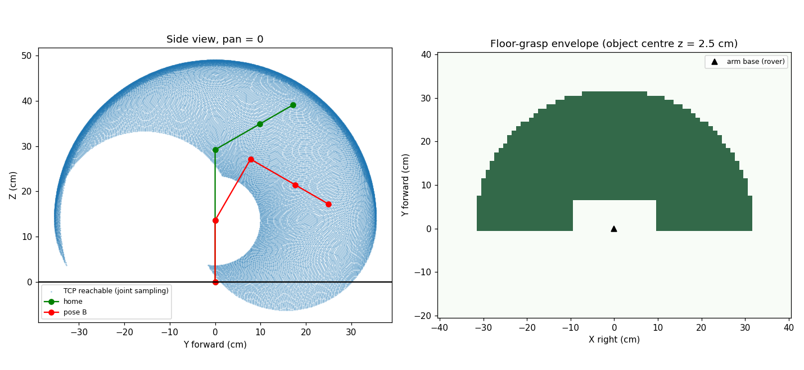
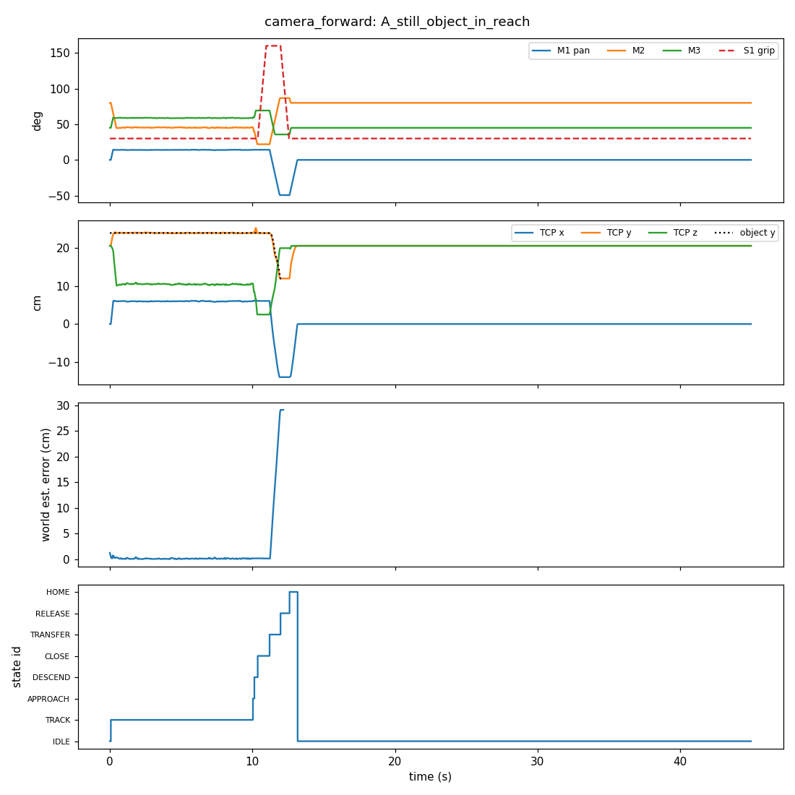
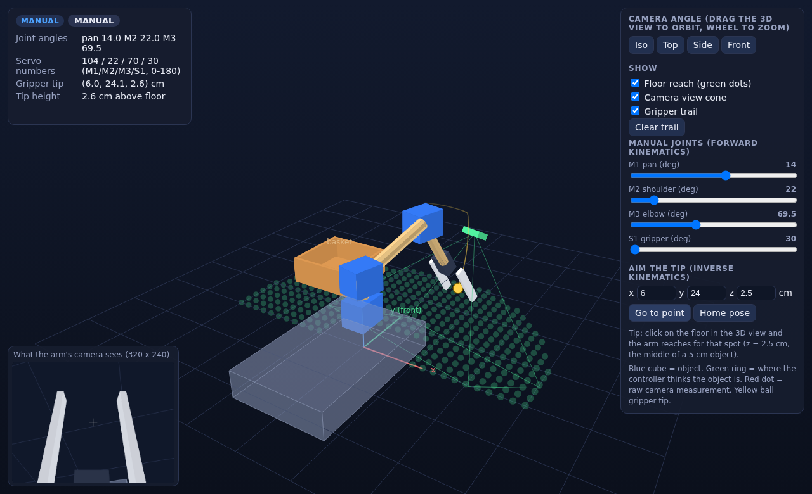
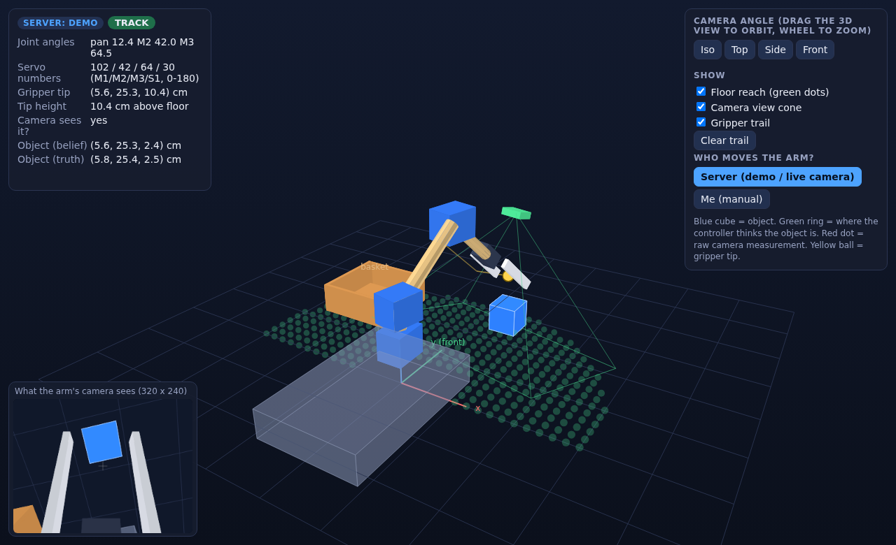

# How it all works (in plain language) - and how to see your arm in 3D

You do not need to be an engineer to follow this. Every technical word is explained the first time it shows up, every
number comes from something I actually ran, and where I have not tested something I say so.

**What you already have:** a camera that finds a blue object and measures where it is, streaming about 30-47 frames a
second to your PC. Most people who start robot projects never get that far. What this guide adds is the understanding
of the rest: the math that turns "the object is there" into "move the motors to these angles", and a 3D picture of it.

**How to read it.** Parts 1-3 explain what exists and what the pictures mean. Part 4 is the math, slowly. Part 5 is the 3D
viewer. Part 6 is how to pause the project for a few months and pick it up again. You can skip around; each part says
what it needs.

Contents: 1 Words you will meet - 2 The big picture - 3 Running it and reading every output - 4 The math -
5 The 3D viewer - 6 Pausing and restarting - 7 Troubleshooting - 8 Cheat sheet

---

## 1. Words you will meet

| Word | Plain meaning |
|---|---|
| **Joint** | A place where the arm bends or turns. Yours has three: M1 (turns left/right), M2 (shoulder, up/down), M3 (elbow, up/down). |
| **Link** | A stiff piece between two joints. Yours: the 15.6 cm piece (M2 to M3) and the 11.3 cm piece (M3 to the gripper servo). |
| **Servo** | A small motor that turns to an angle you ask for (0-180 degrees) and holds it. |
| **Axis / x, y, z** | Three directions. In this project **x = right, y = forward, z = up**, measured in centimetres from a point on the floor under the arm's base. |
| **Origin** | The point (0, 0, 0): the floor under the arm base. |
| **Tool tip (TCP)** | The point that has to land on the object: the middle of the grip zone, 19.8 cm beyond the elbow along the second link. "TCP" just means tool centre point. |
| **Forward kinematics (FK)** | *Angles in, position out.* "If the joints are at these angles, where is the gripper?" Easy math. |
| **Inverse kinematics (IK)** | *Position in, angles out.* "I want the gripper there - what angles do I set?" The reverse, and harder. |
| **Reach / workspace** | All the places the tool tip can get to. |
| **Joint limit** | How far a joint is allowed to turn (your servos: 0-180). |
| **Singularity** | A pose where the math loses a choice, for example the arm stretched out completely straight. Small angle errors become big position errors near it. |
| **Calibration** | Measuring the real thing and typing the measured numbers into the model so the model matches reality. |
| **Noise** | Small random wobble in a measurement (the same still object reads 24.0, 24.2, 23.9...). |
| **Dropout** | A frame where the camera simply fails to find the object. Yours happens on roughly a quarter to a third of frames. |
| **Filter (EMA)** | A way to smooth noisy readings: move your estimate a fraction of the way toward each new reading. |
| **State machine** | A program that is always in exactly one named mode (IDLE, TRACK, ...) and switches modes when something happens. |
| **Slew rate** | How fast a servo is allowed to move (we limit it to 90 degrees per second). |
| **Pixel** | One dot of the camera image. Your image is 320 wide and 240 tall. |
| **Focal length (fx, fy)** | A camera number (in pixels) that says how much the scene is magnified. Yours: fx 202.8, fy 210.9 from your calibration. |
| **Camera frame vs world frame** | The same point described two ways: relative to the camera ("20 cm in front of the lens") or relative to the floor under the arm ("x=6, y=24, z=2.5"). Converting between them is a key step. |
| **Rotation matrix** | A neat way to store "which way is the camera facing". You can think of it as three arrows: camera-right, camera-down, camera-forward, each written in world coordinates. |
| **Open loop / closed loop** | Open loop: decide once, then execute blindly. Closed loop: keep looking and correcting while moving. The grab in this project is open loop for the last few centimetres. |
| **Tolerance** | How wrong is still acceptable. The simulation calls a grab a success if the tool tip ends within 2 cm of the object's centre (an assumption, not measured). |
| **Monte Carlo** | Running the same test many times with random errors to see how often it works. |
| **Shadow mode** | Real camera data goes through the controller but no motors move; you only watch what the arm *would* do. |

---

## 2. The big picture

There are three separate programs and some hardware. Keeping them apart in your head removes most of the confusion.

```
 REAL WORLD                         YOUR PC                                   ARM SIMULATION (Python)
 ----------                         -------                                   -----------------------
 ESP32-S3 + camera  --WiFi-->  server.py (uvicorn)                       arm_model.py       the arm's geometry + FK + IK
 (takes pictures)              finds the blue object,                    sim_camera.py      a PRETEND camera
                               measures x, y, z in cm                    arm_controller.py  the decision-making (state machine)
                               in the camera's own frame                 run_sim.py         runs it all, makes plots
                                       |                                 live_bridge.py     feeds REAL camera numbers in
                                       |  /latest  (the newest result)   viewer_server.py + viewer/index.html
                                       +--------------------------------> the 3D picture in your browser
```

**What must be switched on for what:**

| I want to... | PC | ESP32-S3 camera | `server.py` running | servos |
|---|---|---|---|---|
| Run the tests, `run_sim.py`, the sweeps | yes | **no** | **no** | no |
| Open the 3D viewer by itself (manual sliders) | yes (a browser) | no | no | no |
| Watch the 3D **demo** (pretend object) | yes | no | no | no |
| `live_bridge.py` (text output from real camera) | yes | **yes** | **yes** | no |
| Watch the 3D arm follow a **real** object | yes | **yes** | **yes** | no |
| Move a real arm | **not possible yet:** there is no servo firmware | | | |

So the simulation itself is *just a program on your PC*. Your ESP32 only matters when you want real camera data.

---

## 3. Running it and reading every output

### 3.1 Run it
Open PowerShell in the `arm_simulation` folder (see `RUN_AND_COMMIT.md` for the first-time setup), then:
```powershell
python test_model.py      # 8 checks: the geometry and logic behave as expected -> 8 lines starting with PASS
python test_bridge.py     # 2 checks: real-camera plumbing works             -> 2 PASS
python test_viewer.py     # 3 checks: the 3D viewer's math matches Python    -> 3 PASS
python run_sim.py         # the main simulation (about 25 seconds)
```
A `PASS` means a check I wrote came out true. It does **not** mean your real arm is accurate - section 4.9 explains the difference.

### 3.2 What `run_sim.py` does
It runs three little stories (called scenarios) for **two designs**:
- **as_measured**: the camera bracket where it is today (7.6 cm along the arm).
- **camera_forward**: the bracket moved forward to 13 cm (what the simulation recommends).

In each story a pretend blue 5 cm cube sits on the floor, a pretend camera mounted on the pretend arm looks at it (with noise and
dropouts), the controller decides, and the pretend servos move at a limited speed. At the end it writes files into `results/`.

### 3.3 The seven pictures
There are seven because 1 workspace picture + 3 stories x 2 designs = 7.

**`workspace.png` - where can the arm reach?** (two panels)



- *Left, "Side view, pan = 0":* look at the arm from the side. Each blue dot is a place the gripper tip can reach if you try every
  combination of M2 and M3. The empty hole in the middle is where the arm cannot go because it can't fold into itself. The green
  stick figure is the arm at the "home" pose, the red one is another pose. Some dots are below the black floor line or inside the car -
  this panel is raw geometry; it does not know about the floor. (The right panel does.)
- *Right, "Floor-grasp envelope":* look from above. Dark green = spots on the floor where a 5 cm object can be grasped. It is a half circle
  about 31 cm in radius. The notch next to the triangle (the arm base) is the car-body box, which is a **guess** until you measure the car.
  *What to do with it:* it tells you how close the rover must park to the object: roughly 15-28 cm in front of the arm.

**The six story pictures** have the same four panels. Here is `camera_forward_A_still_object_in_reach.png`:



| Panel | What is drawn | How to read it |
|---|---|---|
| 1 (top) | The four servo angles over time: M1 pan, M2, M3 and S1 (the gripper, dashed red). | At t=0 the arm leaves its search pose and settles above the object. Around 10-13 s the grab happens: S1 jumps from 30 (open) to 160 (closed), then the arm swings to the basket (M1 goes to about -49) and the gripper opens again. |
| 2 | The gripper tip's x, y, z in cm, plus the object's true y (dotted black). | The tip's y sits on top of the dotted line: it is following the object. While tracking, the tip hovers at z of about 10.5 cm (8 cm above the 2.5 cm object centre). It dips to 2.5 for the grab, then rises to about 20 for the basket. |
| 3 | How far the controller's belief about the object's position is from the truth. | About 0.2 cm while tracking (good). **The spike to ~30 cm at the end is not a real error:** while the arm is carrying the object the controller stops updating, so the number is meaningless there. |
| 4 (bottom) | Which mode the state machine is in. | IDLE, then TRACK for about 10 s, then APPROACH, DESCEND, CLOSE, TRANSFER, RELEASE, HOME, back to IDLE. |

- **Story A** (`..._A_still_object_in_reach`): the object sits still. The arm waits 10 seconds, then grabs it. The delivery works.
- **Story B** (`..._B_moving_then_still`): the object slides for 8 seconds and then stops. Notice the grab does not start until about 18 seconds = 8 + 10. The
  10-second stopwatch restarts whenever the object drifts more than 2 cm from where it was when the stopwatch started.
- **Story C** (`..._C_object_out_of_reach`): the object is 55 cm away. **Everything is a flat line and the bottom two panels are empty.** That is not the arm "deciding it
  is too far": at the search pose the camera simply cannot see an object that far away, so nothing ever starts. It does prove the arm does nothing silly in that case.
- **`as_measured_...` versus `camera_forward_...`:** the same stories with the other design. They look alike at the exact measured 60 degree camera tilt. The difference only
  shows up when the tilt is slightly wrong (section 3.5, `position_sweep`).

### 3.4 The data files
| File | What is inside | Numbers worth knowing |
|---|---|---|
| `results/summary.json` | One entry per story and design. | `object_delivered` (true/false); `grasp_error_cm` (how far the tip was from the object's true centre when closing started - only the simulator can know this); `detection_rate_...` (share of frames where the camera found the object); `world_estimate_error_median_cm`; `max_servo_rate_deg_s` (should equal the 90 limit); `chassis_collision_frames` (should be 0); `states_visited` (the mode sequence); `noise_only_monte_carlo_A` (20 repeats with only camera noise: 20 of 20 succeed). |
| `results/sensitivity.json` | "What if my measurement is wrong?" | `one_at_a_time`: one number is made wrong in the pretend real arm and the result recorded. `monte_carlo_mismatch`: 40 runs with *all* numbers slightly wrong at once. |
| `results/design_sweep.json` | Which bracket position and search pose let the camera see the floor objects. | `worst` = worst case across camera tilts of 55, 60, 65 degrees (1.0 = perfect, 0.11 = nearly blind). |
| `results/position_sweep.json` | 15 object positions x 3 true camera tilts, per design. | How many grabs completed out of 15. |

### 3.5 What the experiments showed
- **Camera placement matters a lot.** If the real tilt is 55 or 65 degrees instead of the assumed 60, the current bracket completes only 4/15 and 7/15 grabs; the 13 cm
  bracket completes 15/15 and 13/15. At exactly 60 degrees both complete 15/15. (`design_sweep` agrees: the worst-case coverage is 11% at 7.6 cm, 83% at 12 cm, 91% at 13 cm, 100% at 14 cm.)
- **Wrong measurements cost accuracy.** With realistic hand-measurement mistakes, only about 31-32 of 40 runs put the tool tip within 2 cm of the object; the typical (median) miss was
  about 1.1-1.2 cm and the worst about 3.4 cm. The one-at-a-time results: camera tilt off by 5 degrees costs about 1.7-2.0 cm; grip reach off by 1.5 cm costs about 1.5 cm; M3 zero off by
  5 degrees costs about 1.0 cm; M2 zero off by 2 degrees costs about 0.9 cm; a link 0.5 cm too long costs about 0.5 cm.
  **These come from errors I chose, not from measuring your arm.**
- **The rear of the car is out of reach.** The arm cannot fold back far enough to drop something low onto the back deck. A side-front basket at (-14, 12, 20) cm works with plenty of margin.

### 3.6 Five experiments to try (this is how you learn what each number does)
After each change run `python run_sim.py` and look at the pictures.
1. **Shorter wait.** In `arm_controller.py` find `dwell_s: float = 10.0`, set it to `5.0`. In story B the grab now starts about 5 s after the object stops.
2. **Move the camera.** In `designs.py` change `cam_along=13.0` to `7.6` for camera_forward; run `python position_sweep.py` and compare the 15/15 results.
3. **Worse camera.** In `sim_camera.py` change `dropout: float = 0.25` to `0.6`. Does the arm still track? (Look at panel 3 of story A.)
4. **Impossible object.** Open `viewer/index.html`, type x=0, y=60, z=2.5, press *Go to point*: you get a plain-words reason it can't.
5. **Move the basket.** Change `basket` in `arm_controller.py`. *Careful:* if the new spot is out of reach, the simulator quietly aims for the nearest reachable point instead of
   complaining. Test any new basket spot in the 3D viewer first.

### 3.7 Calibration in plain words
The model is only as good as the numbers in it. Calibration = measure the real arm better and put the better numbers in. Biggest first:

| Measure this | How (with what you have) | Where the number goes | Matters |
|---|---|---|---|
| **Camera tilt** (assumed 60 degrees) | Put a marker where you can measure two things with a ruler: how far *ahead along the arm* (`a`) and how far *below the camera* (`d`) it is. Note which pixel row `v` it appears on. Then `marker angle = atan(d/a)`, `offset = atan((v - 112.3) / 210.9)`, **tilt = marker angle - offset**. Example: `a`=10 cm, `d`=17.3 cm gives 60 degrees; if it shows in the middle row (v = 112) the tilt is 60. | `cam_pitch_deg` in `arm_model.py` (`ArmParams`) | 5 degrees off = ~2 cm |
| **Grip reach** (7-10 cm guess) | Close the gripper on a pencil; measure from the gripper servo's axle to where the pencil sits. | `grip_reach` | 1.5 cm off = ~1.5 cm |
| **Servo zero and direction** | Command the angle, measure the arm with a protractor. For M3 run `python calibrate_m3.py 0:-60 90:30 180:120` with *your* three readings. | `m3_dir`, `m3_rel_at_mean_deg`. For M1/M2 the code assumes "90 = straight ahead" and "M2 90 = straight up"; if yours are off, tell me the readings and I will add offset parameters | 2-5 degrees off = ~1 cm |
| **Link lengths, base height, camera position on the arm** | Ruler, pivot-screw to pivot-screw. | `L2`, `L3`, `m2_rise`, `base_height`, `cam_along`, `cam_perp` | 0.5 cm off = ~0.5 cm |
| **Car body outline** | Ruler. | `chassis` (x0, x1, y0, y1, top) | stops the model colliding with the car |
| **Basket position** | Ruler. | `basket` in `arm_controller.py` | needs to be reachable |

You can tell calibration worked later, on the real arm: the model says "tool tip at (6, 24, 2.5)", you command it, then measure with a tape. Within 1 cm = good model.

---

## 4. The math, slowly

Everything below is exactly what the code does (`arm_model.py`). I use **camera_forward** numbers.

### 4.1 Coordinates and angles
x = right, y = forward, z = up, all in cm, origin on the floor under the arm base. The M1 axis is 10 cm above the floor and the M2 pivot is 3.6 cm above that,
so the **shoulder is at z = 13.6**.

Two facts from school trigonometry do almost all the work. If something of length `L` points at angle `a` above horizontal:
- it reaches `L x cos(a)` sideways (horizontally), and
- it reaches `L x sin(a)` upward.

### 4.2 Forward kinematics (angles in, position out)
Joint angles `q = (pan, M2, M3)`. In `fk()`:
1. **Pan spins everything.** The arm lives in one vertical "page" and `pan` turns the page. Define `u = (sin pan, cos pan, 0)`: the direction on the floor the page faces.
   pan = 0 gives (0, 1, 0), straight forward; pan = 90 gives (1, 0, 0), to the right.
2. **First link (M2 to M3).** Its angle above horizontal is `a2 = M2`. The elbow is at
   `M3 point = shoulder + 15.6 x ( cos(a2) x u + sin(a2) x up )`.
3. **Second link.** Its angle above horizontal is `a3 = a2 + (M3 - 90) - 60`. The `-60` is how your M3 servo is mounted (so M2=90, M3=90 points the second link 30 degrees above horizontal).
4. **Tool tip** `= M3 point + 19.8 x ( cos(a3) x u + sin(a3) x up )` (19.8 = 11.3 + 8.5).

**Worked example 1: q = (0, 90, 90).** a2 = 90 (straight up): M3 point = (0, 0, 13.6 + 15.6) = (0, 0, 29.2). a3 = 90 + 0 - 60 = 30 degrees.
Direction = (0, cos30, sin30) = (0, 0.866, 0.5). Tip = (0, 19.8 x 0.866, 29.2 + 19.8 x 0.5) = **(0, 17.15, 39.1)**. The code prints exactly that.

**Worked example 2: q = (30, 60, 60).** u = (0.5, 0.866). a2 = 60: M3 point = (15.6 x 0.5 x 0.5, 15.6 x 0.5 x 0.866, 13.6 + 15.6 x 0.866) = **(3.9, 6.75, 27.11)**.
a3 = 60 + (60 - 90) - 60 = -30 degrees (pointing downward). Direction = (0.866 x 0.5, 0.866 x 0.866, -0.5) = (0.433, 0.75, -0.5).
Tip = (3.9 + 8.57, 6.75 + 14.85, 27.11 - 9.9) = **(12.47, 21.6, 17.21)**. Matches the code.

**Try these in the viewer (sliders), predict first.** Answers from the code:
1. q = (0, 0, 90): where is the tip? **(0, 25.5, -3.55)**. A negative height means this pose pushes the gripper through the floor - IK refuses poses like that.
2. q = (0, 90, 150): **(0, 0, 49.0)**. The whole arm points straight up: the tallest the tip can be.
3. q = (90, 90, 90): **(17.15, 0, 39.1)**: example 1 turned 90 degrees to the right.

### 4.3 Inverse kinematics (position in, angles out)
Target: a 5 cm cube on the floor at **(6, 24, 2.5)** (2.5 = half the cube's height). The trick is to split the problem:

**Step 1 - pan.** Which way is the target? `pan = atan2(x, y) = atan2(6, 24) = 14.04 degrees`. (`atan2` is "the angle whose opposite side is x and adjacent side is y".)

**Step 2 - flatten into a side view.** After panning, the problem lives in one vertical page. Distance along the floor `r = sqrt(6^2 + 24^2) = 24.74`. Height of the target above the shoulder
`dz = 2.5 - 13.6 = -11.1`. Straight-line distance shoulder to target `D = sqrt(r^2 + dz^2) = 27.11 cm`.

**Step 3 - a triangle.** The two arm pieces (15.6 and 19.8 cm) and the line D form a triangle with all three sides known. The **law of cosines** gives the elbow bend `rel`:
`cos(rel) = (D^2 - 15.6^2 - 19.8^2) / (2 x 15.6 x 19.8) = (735 - 243.4 - 392) / 617.8 = 0.1616`, so `rel = +/- 80.7 degrees`.

**Step 4 - shoulder angle.** `a2 = atan2(dz, r) - atan2(19.8 x sin(rel), 15.6 + 19.8 x cos(rel))`.
The `+/-` gives **two answers** (elbow bent one way or the other):
| Branch | M2 | M3 | Allowed? |
|---|---|---|---|
| rel = -80.7 | 21.9 degrees | 69.3 degrees | **yes** |
| rel = +80.7 | -70.3 degrees | 230.7 degrees | no: outside the 0-180 servo range |

(M3 comes from `M3 = rel + 60 + 90`.) So the answer is `pan = 14.04, M2 = 21.9, M3 = 69.3`.

**Step 5 - check it.** Put those angles back into forward kinematics: the tip lands on (6, 24, 2.5). The code does this check in its tests for thousands of random poses (error about 0.00000000000001 cm).

**Servo numbers.** M1 goes 0-180 with 90 = straight ahead, so the number to send is `pan + 90 = 104.04`. M2 = 21.9, M3 = 69.3, gripper 30 (open) or 160 (closed).

**Why IK can say "no solution":** the triangle can't be built if D is longer than 15.6 + 19.8 = 35.4 cm (too far) or shorter than 19.8 - 15.6 = 4.2 cm (too close); or both branches break a joint limit, go below the floor, or hit the car box.
Those two "straight" extremes are the **singularities**: right next to full stretch a tiny angle change moves the tip a lot, so accuracy gets worse near the edge of the reach.

**What this arm cannot do:** it has no wrist, so you cannot choose the angle the gripper approaches from; the tool direction is forced by the geometry. For a floor object it comes down steeply: about 84 degrees below horizontal at 15 cm out, 71 at 20 cm, 43 at 30 cm.

### 4.4 The camera math
**Pinhole formula** (how a 3D point lands on the image). A point `X` right, `Y` down, `Z` forward of the camera lands at
`u = cx + fx x X / Z` and `v = cy + fy x Y / Z`, with `fx = 202.8, fy = 210.9, cx = 156.9, cy = 112.3` from your calibration.
Example: `X = 2, Y = -1, Z = 20` gives `u = 156.9 + 202.8 x 2/20 = 177.2` and `v = 112.3 + 210.9 x (-1)/20 = 101.8`.

**Depth from size** (how your server finds Z with one camera). A 5 cm object at distance Z looks `5 x fx / Z` pixels wide. At 20 cm: `5 x 202.8 / 20 = 50.7` pixels. Backwards: `Z = 5 x fx / pixels`.
The weakness: one pixel of measuring error means about 0.2 cm of depth error at 15 cm, 0.6 cm at 25 cm, 1.6 cm at 40 cm. That is why the working distance matters.

**Backwards:** `X = (u - cx) x Z / fx`, `Y = (v - cy) x Z / fy`. That is what `server.py` outputs: x_cm, y_cm, z_cm **relative to the camera**.

**Camera frame to world frame** (`cam_to_world`). The arm needs the object relative to the *floor under the base*, not relative to a camera that is mounted on a moving arm. The camera sits at a known point on the arm and
faces a known way (both come from forward kinematics), so: `world point = camera position + (camera-right x X) + (camera-down x Y) + (camera-forward x Z)`.
Those three arrows are the "rotation matrix". Example at the search pose (0, 80, 45): the camera is at (0, 18.42, 31.9) looking almost straight down, so the camera-frame point (2, -1, 20) becomes the world point **(2, 21.16, 12.06)**.
Because the transform uses the arm's pose **when the frame was taken**, it keeps working while the arm moves.

### 4.5 Smoothing, the 10-second rule and speed limits
- **Smoothing (EMA).** New belief = old belief + 0.25 x (new reading - old belief). If the belief is 20.0 and the reading is 22.0, the belief becomes 20.5. Noise averages out; real movement still gets followed. Readings that jump more than 12 cm in one frame are thrown away as errors.
- **The 10-second rule.** When the stopwatch starts, remember the object's position (the *anchor*). Each frame, if the belief is within 2 cm of the anchor the stopwatch keeps running; if not, the anchor moves to the new spot and the stopwatch resets. At 10.0 s the grab begins.
- **Speed limit.** Each joint may move at most 90 degrees per second: at 30 updates a second that is 3 degrees per update. This keeps motion smooth and gentle on the battery.

### 4.6 The state machine in words
IDLE (arm waits at the search pose; needs 3 detections in a row) -> TRACK (hovers 8 cm above the object and follows it; if it is lost for 1.5 s go back to IDLE; if it is out of reach the arm stays at the search pose and raises a "rover should move closer" flag)
-> after 10 s of stillness: APPROACH (6 cm above, aiming at a frozen point) -> DESCEND -> CLOSE (0.8 s) -> TRANSFER (swing to the basket) -> RELEASE (0.6 s) -> HOME -> a 3 s pause -> IDLE.

### 4.7 Mathematically right is not the same as physically right
IK answers: "which angles put the *model's* tool tip on the target?" It gives that answer perfectly, every time. If the real second link is 0.5 cm longer than your model, or the M2 servo's 90 is really 92, the real arm
goes somewhere else - and the math still reports success. Closing that gap is calibration (3.7). The `PASS` messages prove the code matches the model; only a tape measure on the real arm proves the model matches reality.

---

## 5. The 3D viewer

### 5.1 What it is (and what it is not)
A 3D picture of your arm in your web browser that you can rotate and zoom, driven by the same math as the simulation. It has three modes:

| Mode | You start it with | What happens | ESP32 needed? |
|---|---|---|---|
| **Manual** | double-click `viewer\index.html` | Move sliders (forward kinematics), type a target point or click the floor (inverse kinematics). | no |
| **Demo** | `python viewer_server.py --demo`, open http://localhost:8010 | A pretend object slides and rests; the arm tracks it, waits 10 s, grabs it, drops it in the basket; a new object appears. | no |
| **Live** | `python viewer_server.py --live http://localhost:8000/latest` | Your real camera sees a real object; the 3D arm moves as the real arm would. | **yes** (plus `server.py`) |

It is made of simple shapes (boxes, tubes), not your actual parts, and nothing real moves. When you have printed parts you can make it look like them (Part 6).



### 5.2 What is on the screen
- **Blue boxes** = the three servos. **Tan tubes** = the arm pieces. **White prongs** = the gripper jaws (they open and close with S1). **Green board + green cone** = the camera and what it can see. **Yellow ball** = the tool tip. **Yellow line** = the tip's trail.
- **Translucent grey box** = the car body keep-out box (a guess). **Orange box** = the basket. **Green dots on the floor** = where a floor object can be grasped.
- **Blue cube** = the object. **Green ring** (and cross) = where the controller *believes* the object is. **Red dot** = the raw camera measurement (live mode).
- **Bottom-left inset** = what the arm's own camera sees, drawn with the same pinhole formula as section 4.4. Notice the two white jaws at the sides: with the camera bracket at 13 cm the jaws appear in the image; the object has to sit between them.
- **Top-left panel** = mode, state, joint angles, servo numbers, tool tip position, and in server modes whether the camera sees the object, the controller's belief and (in demo) the truth.
- **Mouse:** drag to orbit, wheel to zoom. Buttons give Iso / Top / Side / Front views.



### 5.3 How to run it
1. **Manual:** open `arm_simulation\viewer\index.html` in Chrome or Edge. Try the exercises in 4.2.
2. **Demo:** in PowerShell inside `arm_simulation`: `python viewer_server.py --demo`, then open `http://localhost:8010`. Add `--speed 2` for double speed. The page has a "Me (manual)" button to take control and a "Server" button to hand it back.
3. **Live** (needs the real pieces from `RUN_AND_COMMIT.md` section 4):
   - Terminal 1 in `bluephilic`: `uvicorn server:app --host 0.0.0.0 --port 8000`, ESP32 streaming.
   - Terminal 2 in `arm_simulation`: `python viewer_server.py --live http://localhost:8000/latest`. It prints where to hold the camera: for camera_forward, about **18.4 cm forward of the arm's base point and 31.9 cm above the table, looking straight down**.
   - Mark an "arm base point" on a table, hold the ESP32 at that position on a stand or a stack of books, put a blue object under it, open `http://localhost:8010`. Slide the object around: the cube follows, the arm hovers over it. Hold it still for 10 s and the arm does its grab sequence (the real object stays where it is - nothing removes it).
   - Where you hold the camera sets how accurate the picture is; being a couple of centimetres off just shifts everything by about that much. Good enough for a demo.

### 5.4 How it works inside (so you can change it)
Everything is in `viewer/index.html`, in four labelled parts:
1. **The math** - `fk()`, `ik()` and friends: a line-by-line copy of `arm_model.py`. In my own run, 2,407 values from the JavaScript and the Python agreed to better than 1e-12; `test_viewer.py` repeats the comparison with a smaller random sample.
2. **Drawing 3D on a flat screen** - a "camera" turns every 3D point into a pixel with the same pinhole formula as section 4.4. Shapes are cut into flat polygons and painted from far to near (the *painter's algorithm*), with a simple light for shading. No libraries: it works offline.
3. **The picture** - `buildPicture()` creates the floor, car, basket, arm, camera, object and trail. This is the function to change when you have real parts.
4. **The window** - buttons, sliders, mouse, and reading the latest state from `viewer_server.py` 30 times a second.

`viewer_server.py` is a small program that runs the **same controller** as `run_sim.py` and shares its results at `/state` (the arm pose and object positions) and `/config` (the arm's numbers). The browser only draws.

**Easy changes:** colours are in the `COL` table; the size of the cube is the `2.5` half-size in `buildPicture`; the pretend object paths are `EPISODES` in `viewer_server.py`; the arm's numbers come from `designs.py`.

### 5.5 Why not MATLAB / Simulink / Blender / SolidWorks?
| Tool | Good for | Why not first |
|---|---|---|
| **MATLAB / Simulink** | Control-system studies, tidy plots, block diagrams. 3D needs the Robotics or Simscape add-ons and usually a CAD model. | You don't have the CAD parts yet, it needs a licence, and feeding it live data from your camera is a lot of plumbing. Worth a look later if a report needs Simulink diagrams. |
| **SolidWorks / CAD** | Designing the real parts and checking they fit. | Excellent for the printing stage; not a live simulation of tracking. |
| **Blender** | Beautiful animations. | Scripting the controller in is hard, and it is not made for live data. |
| **This web viewer** | Live 3D that anyone can open, shows your real control logic. | Simple shapes, no physics. |

### 5.6 A three-minute way to present it
1. *(30 s)* Run the demo. "A camera on the arm finds a blue object and the arm follows it."
2. *(60 s)* Pause on TRACK. Point at the inset: "this is what the arm's camera sees" - then at the HUD: belief versus truth are within a fraction of a centimetre.
3. *(45 s)* Let it hold still: "after 10 seconds of stillness it grabs, carries it to the basket, and releases".
4. *(45 s)* Switch to manual, click the floor, then far away to show the plain-words "too far" message: "the math knows its own limits".
Honest line to include: "this is a simulation; the next step is calibrating against the real arm."

### 5.7 What I tested, and what I did not
Tested here: the viewer's math against Python (2,407 values in my run), a real headless browser (no JavaScript errors in manual and demo modes), all four demo objects delivered, the server's `/state` and `/config`, live-polling logic against a pretend vision server.
**Not tested:** your computer and browser, and a live run with a real ESP32 and a real object.

---

## 6. Pausing the project for a few months, and restarting

**Before you pause**
1. Commit everything to GitHub and tag it: `git tag -a sim-v1 -m "3D viewer and simulation working"` then `git push --tags` (steps in `RUN_AND_COMMIT.md`).
2. Keep `SPEC.md` up to date: it is the one page that explains your arm and what is still guessed.
3. Write down, with the date, every real measurement you have (tilt, lengths, servo zeros) - even rough ones.
4. Keep this guide and `GUIDE.md` in the repo. Together they explain every decision.

**When the printer arrives - design for what the simulation taught you**
- Make the camera bracket **adjustable along the arm** (about 7 to 14 cm) and keep a way to fine-tune its tilt with a screw; sensitivity to camera tilt was the biggest finding.
- Add **zero marks** on each servo horn and joint, so "90 degrees" is a physical mark you can check with a protractor.
- Make the car's basket spot reachable (side-front of the base works; the rear deck at low height does not, with this joint range).
- Consider a wrist: without one, the gripper can only come down steeply.
- Measure each printed part with calipers and note the numbers.

**When you restart**
1. Replace the cardboard numbers in `ArmParams` (`arm_model.py`) and the search pose/bracket in `designs.py` with your measured numbers.
2. Run `python test_model.py`, `python test_bridge.py`, `python test_viewer.py` (they should still pass; if a test now fails, read which number you changed - that is the test doing its job).
3. Re-run `python run_sim.py` and `python sensitivity.py`; look at the pictures again.
4. Update the shapes in `buildPicture()` so the 3D view matches your printed parts, then continue with the stages in `GUIDE.md` (servo firmware first).

---

## 7. Troubleshooting

| Problem | Likely cause and fix |
|---|---|
| The viewer page is blank | Use Chrome or Edge. Press F12 and look at the Console for a red error; tell me what it says. |
| The viewer shows "Lost connection to viewer_server.py" | The Python server was stopped. Start it again and refresh. |
| Live mode: "waiting: the vision server has no frames yet" | The ESP32 is not streaming to `server.py`. Check its Serial Monitor. |
| Live mode: "cannot reach the vision server" | `uvicorn` is not running, or the address/port differs (`--live http://localhost:8000/latest`). |
| Live mode: the cube jumps around | The camera isn't held still, the lighting changed (re-tune the blue colour range), or the object size in `server.py` (`OBJECT_SIZE_CM`) doesn't match the real object. |
| `python viewer_server.py` says port in use | Add `--port 8011` and open that port instead. |
| A test says `SKIP (node is not installed)` | Harmless: that test only compares the viewer math with Python and needs Node.js. |
| `ModuleNotFoundError` | You're not inside the `arm_simulation` folder, or run `pip install -r requirements-sim.txt`. |

---

## 8. Cheat sheet
```powershell
cd C:\Users\User\bluephilic\arm_simulation
python test_model.py ; python test_bridge.py ; python test_viewer.py     # all should say PASS
python run_sim.py                          # simulation + pictures in results\
python viewer_server.py --demo             # then open http://localhost:8010
python viewer_server.py --live http://localhost:8000/latest   # real camera in 3D (needs uvicorn + ESP32)
python live_bridge.py --url http://localhost:8000/latest      # real camera as text only
python calibrate_m3.py 0:-60 90:30 180:120                    # replace with your protractor readings
```
**Files to read next:** `SPEC.md` (your arm's numbers), `GUIDE.md` (the staged plan to a real arm), `RUN_AND_COMMIT.md` (setup and GitHub).
